<div align="center">

<pre>
┌────────────────────────────────────────────────────────────────────────┐
│  ██████╗ ██╗   ██╗ █████╗ ███╗   ██╗███████╗███╗   ██╗██████╗ ██████╗  │
│ ██╔════╝ ╚██╗ ██╔╝██╔══██╗████╗  ██║██╔════╝████╗  ██║██╔══██╗██╔══██╗ │
│ ██║  ███╗ ╚████╔╝ ███████║██╔██╗ ██║█████╗  ██╔██╗ ██║██║  ██║██████╔╝ │
│ ██║   ██║  ╚██╔╝  ██╔══██║██║╚██╗██║██╔══╝  ██║╚██╗██║██║  ██║██╔══██╗ │
│ ╚██████╔╝   ██║   ██║  ██║██║ ╚████║███████╗██║ ╚████║██████╔╝██║  ██║ │
│  ╚═════╝    ╚═╝   ╚═╝  ╚═╝╚═╝  ╚═══╝╚══════╝╚═╝  ╚═══╝╚═════╝ ╚═╝  ╚═╝ │
│                                                                        │
│  [IDENTITY]     :: Full Stack AI Engineer & Student Builder            │
│  [AFFILIATION]  :: Bennett University (B.Tech CSE 2024-2028)           │
│  [STATUS]       :: Open to Internships, Research & Contract Roles      │
│  [SPECIALTY]    :: Autonomous Agents • Neural Architectures • RAG      │
│  [PREVIOUS]     :: AI Engineer Intern @ Hypotenuse Analytics           │
└────────────────────────────────────────────────────────────────────────┘
</pre>

  <!-- Monochromatic Dynamic Typing Subtitle -->
  <a href="https://gyanendra.vihar.in/">
    
  </a>

  <br/><br/>

  <!-- Monochromatic Connect Badges -->
  <p align="center">
    <a href="https://gyanendra.vihar.in/" target="_blank">
      
    </a>
    <a href="https://www.linkedin.com/in/gyanendra-prakash-3b6293324/" target="_blank">
      
    </a>
    <a href="https://huggingface.co/spaces/gyaanendra/deepsightsapiens" target="_blank">
      
    </a>
    <a href="https://x.com/Gyaanendra1" target="_blank">
      
    </a>
    <a href="mailto:gyanendraprakash10@gmail.com">
      
    </a>
    <a href="https://instagram.com/codexweeb_44" target="_blank">
      
    </a>
  </p>

</div>

---

### ✦ ABOUT

I am a **3rd-year Computer Science & Engineering student at Bennett University** and a **Full Stack AI Engineer** specializing in **autonomous AI agents**, **Retrieval-Augmented Generation (RAG)** systems, and scalable full-stack architectures. Currently actively building open-source software and open to internship & engineering opportunities.

- **Status** — Available for AI/ML engineering internships, full-stack roles, and research collaborations.
- **Focus** — Autonomous agentic workflows, fine-tuned transformer pipelines (LLMs/RoBERTa), and high-throughput web systems.
- **Experience** — Previously interned as Full Stack AI Engineer at **Hypotenuse Analytics**, where I architected **Meera**—an enterprise AI agent automating meeting intelligence, summaries, and operational workflows.
- **Competitive** — **3x Hackathon Winner**, including **1st Place** at the ACM Bennett Chapter Hackathon 2025 and **3rd Place** at the DeepSight Challenge.
- **Infrastructure** — Self-hoster maintaining a 24/7 dedicated Linux home server and a persistent cloud-based Hermes AI agent.

---

### ✦ SYSTEM ARCHITECTURE

```mermaid
flowchart LR
    subgraph INGEST ["01 // Ingestion & Context"]
        A["User Input / Audio / Judgments"] --> B["Chunking & Normalization"]
        B --> C["Dense Vector Embeddings"]
    end

    subgraph MEMORY ["02 // Memory & Knowledge"]
        C --> D[("Vector DB / Graph Memory")]
        D --> E["Contextual Retrieval"]
    end

    subgraph AGENT ["03 // Autonomous Agent Loop"]
        E --> F["Planner & Prompt Injector"]
        F --> G["Reasoning LLM / RoBERTa"]
        G --> H["Self-Correction & Tool Calling"]
    end

    subgraph OUTPUT ["04 // Delivery"]
        H --> I["FastAPI Microservices"]
        I --> J["Production UI / Telemetry"]
    end
```



---

### ✦ FEATURED PROJECTS

| Project | Stack | Highlights | Links |
| :--- | :--- | :--- | :---: |
| **KnightSight EdgeVision** | `YOLOv11` `ONNX` `PyTorch` `OpenCV` | Ultra-lightweight license plate detector (**2.6M params**) delivering **99.49% mAP@50 at 45 FPS** on low-power edge hardware. | [Demo](https://huggingface.co/spaces/gyaanendra/deepsightsapiens) · [Repo](https://github.com/Gyaanendra/deepsight-sapiens) |
| **LegalMind AI** | `LangChain` `Vector DB` `FastAPI` `Next.js` | Intelligent legal copilot automating citation extraction, case precedent retrieval, and argument structuring via RAG. | [Repo](https://github.com/Gyaanendra) |
| **Criminal Network Analysis** | `NetworkX` `NLP` `FastAPI` `Python` | Graph-based intelligence pipeline built for **Smart India Hackathon (SIH)** surfacing hidden connections across criminal records. | [Repo](https://github.com/Gyaanendra) |
| **Dean Career Cloud (DCC)** | `Next.js` `TypeScript` `TailwindCSS` `Vercel` | Official student career platform and mentorship portal serving university-wide placement cohorts. | [Live Site](https://dcc-wesbite.vercel.app/) |
| **Fake News Classifier** | `RoBERTa` `Ollama` `FastAPI` `React` | Dual-engine verification combining fine-tuned transformer classification (**94.2% accuracy**) with local LLM reasoning. | [Repo](https://github.com/Gyaanendra/AIML-PROJECT-CSET312) |

---

### ✦ EDGE & INFRASTRUCTURE TOPOLOGY

```text
  +-------------------------------------------------------------------------+
  |                    EDGE & INFRASTRUCTURE TOPOLOGY                       |
  +-------------------------------------------------------------------------+
  |                                                                         |
  |  [ Edge Hardware ]                   [ Self-Hosted Linux Server ]       |
  |   Low-Power Embedded Device           24/7 Dedicated Environment        |
  |   |                                   |                                 |
  |   +-- Live Camera / RTSP Stream       +-- Dockerized Microservices      |
  |   +-- OpenCV Frame Preprocessing      +-- Hermes Cloud Agent Host       |
  |   +-- YOLOv11 Engine (2.6M params)    +-- PostgreSQL & Vector Memory    |
  |   +-- ONNX Runtime (45 FPS @ 99.49%)  +-- Cloudflare Tunnels & Reverse  |
  |                                                                         |
  +-------------------------------------------------------------------------+
```

---

### ✦ PAST INTERNSHIPS & HONORS

```yaml
Previous Internships:
  - Role: Full Stack AI Engineer Intern (Past)
    Company: Hypotenuse Analytics
    Impact: "Architected Meera (autonomous meeting transcription & HR agent); streamlined workflow pipelines."
  - Role: Backend Intern (Past)
    Company: Ezlearn
    Impact: "Optimized high-load Django API endpoints; revamped course checkout flow."
  - Role: AppDev Intern (Past)
    Company: nexCraft
    Impact: "Engineered cross-platform mobile client features with React Native."

Achievements & Podiums:
  - 1st Place — ACM Hackathon 2025 (ACM Student Chapter, Bennett University)
  - 3rd Place — DeepSight Challenge 2025
  - Finalist — Neutron Hackathon 2025 (NST Riverhood Campus)
```

---

### ✦ TECH STACK & TOOLING

<details open>
<summary><b>Artificial Intelligence & Machine Learning</b></summary>
<br/>


</details>

<details open>
<summary><b>Full Stack & Web Engineering</b></summary>
<br/>


</details>

<details open>
<summary><b>Backend & Data Systems</b></summary>
<br/>


</details>

<details open>
<summary><b>DevOps, Cloud & Hardware</b></summary>
<br/>


</details>

---

### ✦ ACTIVITY & METRICS

<div align="center">

  <!-- Monochromatic Streak Stats -->
  <a href="https://github.com/Gyaanendra">
    
  </a>

  <br/><br/>

  <!-- Monochromatic Stats & Top Languages -->
  <table border="0" align="center">
    <tr align="center">
      <td>
        <a href="https://github.com/Gyaanendra">
          
        </a>
      </td>
      <td>
        <a href="https://github.com/Gyaanendra">
          
        </a>
      </td>
    </tr>
  </table>

  <!-- Monochromatic GitHub Trophies -->
  <br/>
  <a href="https://github.com/Gyaanendra">
    
  </a>

</div>

---

<div align="center">

  <!-- Monochromatic Footer CTA -->
  <p align="center">
    <a href="https://gyanendra.vihar.in/" target="_blank">
      
    </a>
    <a href="https://www.linkedin.com/in/gyanendra-prakash-3b6293324/" target="_blank">
      
    </a>
    <a href="mailto:gyanendraprakash10@gmail.com">
      
    </a>
  </p>

  <br/>

  <!-- Clean Minimalist Profile View Counter -->
  

</div>
